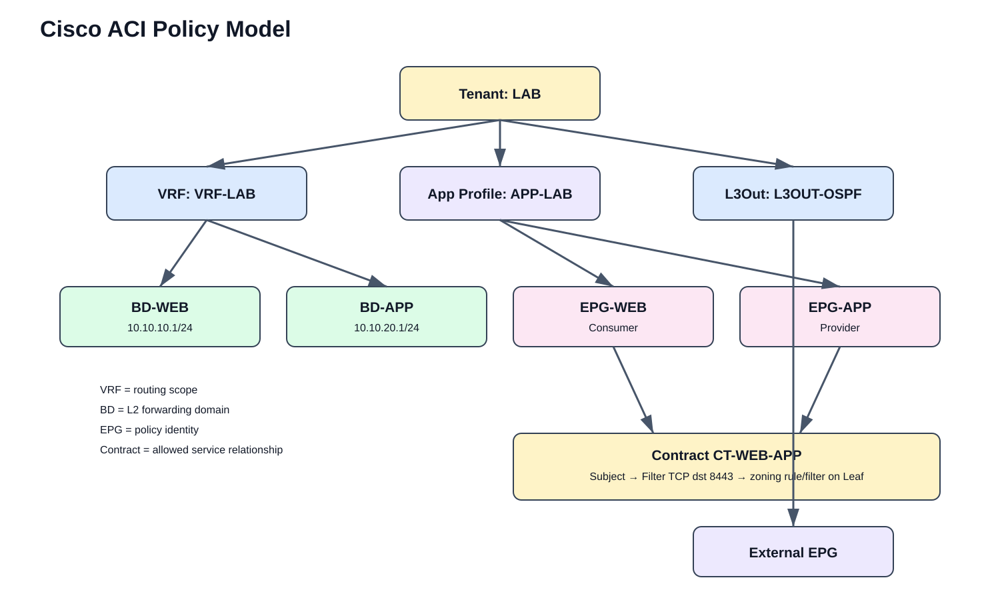
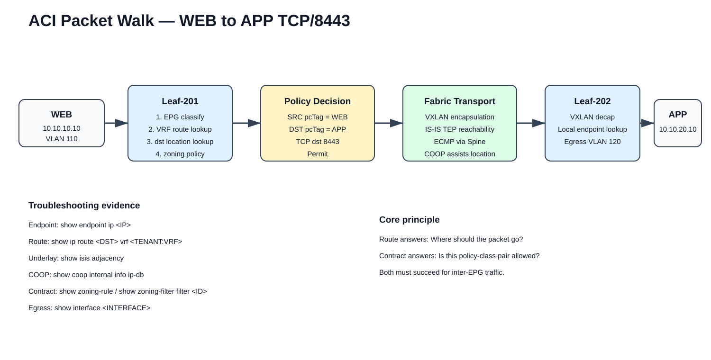

# Cisco ACI Principles and Labs

Cisco ACI를 **명령어 암기보다 원리와 데이터 플레인 동작을 중심으로** 학습하기 위한 저장소입니다.

- 기준 릴리스: **Cisco APIC / ACI 6.2(x)**
- 문서 확인 기준일: **2026-10-06**
- 목표: 실무에서 `왜 이 객체가 필요한지`, `정책이 실제 Leaf에 무엇으로 배포되는지`, `패킷이 어디서 드롭되는지`를 설명할 수 있는 수준
- 대상: 기존 VLAN/STP/OSPF/BGP/Nexus 경험은 있으나 ACI Policy Model을 처음 체계적으로 학습하는 엔지니어

> ACI에서 APIC은 데이터 패킷을 중계하지 않습니다. APIC은 정책/관리 컨트롤러이고, 실제 forwarding과 policy enforcement는 Leaf/Spine fabric이 수행합니다.

## 1. 먼저 잡아야 할 전체 그림

```text
Endpoint
   │ access VLAN (local encapsulation)
   ▼
Leaf ── VXLAN/IS-IS/ECMP ── Spine ── VXLAN/IS-IS/ECMP ── Leaf
 │                            │                               │
 │ EPG classification        │ COOP endpoint DB              │ EPG / Contract enforcement
 │ Distributed GW            │ MP-BGP Route Reflector*       │ L3Out 가능
 │ Policy CAM                 │                               │
 └────────────────────────────┴───────────────────────────────┘
                         APIC Cluster
                 (policy/controller, not data path)

* 선택된 Spine이 MP-BGP RR 역할 수행
```

ACI는 모든 것을 다음 세 층으로 분리해서 보시면 빠릅니다.

1. **물리 Fabric**: Spine-Leaf, TEP, IS-IS, ECMP
2. **Policy Model**: Tenant → VRF / BD / App Profile → EPG → Contract
3. **배포 결과**: endpoint table, route table, COOP DB, zoning rule/filter, hardware forwarding table

## 2. 권장 학습 순서

| 순서 | 문서 | 핵심 질문 |
|---|---|---|
| 1 | [01_ARCHITECTURE.md](docs/01_ARCHITECTURE.md) | ACI가 기존 VLAN 중심 설계와 무엇이 다른가? |
| 2 | [02_FABRIC_BOOTSTRAP.md](docs/02_FABRIC_BOOTSTRAP.md) | APIC/Leaf/Spine은 어떻게 Fabric을 형성하는가? |
| 3 | [03_ACCESS_POLICIES.md](docs/03_ACCESS_POLICIES.md) | 서버 포트 하나를 열기 위해 왜 VLAN Pool/Domain/AEP/Policy Group이 필요한가? |
| 4 | [04_TENANT_VRF_BD.md](docs/04_TENANT_VRF_BD.md) | VRF, BD, Subnet의 역할은 각각 무엇인가? |
| 5 | [05_EPG_STATIC_BINDING.md](docs/05_EPG_STATIC_BINDING.md) | VLAN과 EPG는 같은 것인가? Endpoint는 어떻게 분류되는가? |
| 6 | [06_CONTRACTS.md](docs/06_CONTRACTS.md) | EPG 간 통신은 어디서, 어떤 키로 허용/차단되는가? |
| 7 | [07_VPC.md](docs/07_VPC.md) | ACI vPC는 일반 NX-OS vPC와 무엇이 다른가? |
| 8 | [08_L3OUT.md](docs/08_L3OUT.md) | 외부 라우팅과 보안 정책이 왜 한 객체에 같이 보이는가? |
| 9 | [09_PACKET_WALK.md](docs/09_PACKET_WALK.md) | 실제 패킷은 ingress부터 egress까지 어떻게 이동하는가? |
| 10 | [10_CLI_REST_API.md](docs/10_CLI_REST_API.md) | APIC CLI, Switch CLI, REST API를 언제 각각 쓰는가? |
| 11 | [11_TROUBLESHOOTING.md](docs/11_TROUBLESHOOTING.md) | 장애 시 어디부터 확인해야 가장 빨리 원인을 좁히는가? |
| 12 | [12_LABS.md](docs/12_LABS.md) | 직접 구성하면서 원리를 검증하려면 무엇을 봐야 하는가? |
| 13 | [13_GLOSSARY.md](docs/13_GLOSSARY.md) | ACI 용어를 기존 네트워크 개념과 어떻게 대응시키는가? |
| 14 | [14_COMMAND_INDEX.md](docs/14_COMMAND_INDEX.md) | 장애/검증 목적별로 어떤 명령을 써야 하는가? |

## 3. 실습 토폴로지


정책 관계를 먼저 보려면 다음 그림을 참고하십시오.



패킷 흐름은 다음 그림으로 요약합니다.



## 4. 실습에서 사용할 논리 설계

| 항목 | 값 |
|---|---|
| Tenant | `LAB` |
| VRF | `VRF-LAB` |
| Web BD | `BD-WEB` / `10.10.10.1/24` |
| App BD | `BD-APP` / `10.10.20.1/24` |
| Web EPG | `EPG-WEB`, access VLAN 110 |
| App EPG | `EPG-APP`, access VLAN 120 |
| Contract | `CT-WEB-APP`, TCP/8443 예시 |
| L3Out | `L3OUT-OSPF` |
| External EPG | `EXT-EPG` |
| Border link | 예: `172.16.0.0/31`, 실제 랩에 맞게 변경 |

## 5. 가장 중요한 사고방식

### VLAN은 EPG가 아닙니다

Access VLAN은 endpoint를 Fabric에 들여보낼 때 사용하는 **encapsulation/classification 수단 중 하나**입니다. EPG는 정책을 적용하기 위한 endpoint의 논리 그룹입니다. 동일한 EPG가 여러 Leaf에 걸쳐 존재할 수 있고, Fabric 내부에서는 access VLAN이 아니라 VXLAN과 policy identity를 기반으로 전달됩니다.

### BD는 단순히 “ACI의 VLAN”이 아닙니다

Bridge Domain은 L2 forwarding/flooding domain을 정의하고 VRF에 연결됩니다. Gateway subnet을 두면 ACI Leaf가 distributed/pervasive gateway 역할을 할 수 있습니다. 따라서 VLAN 하나당 SVI 하나라는 전통적 사고와 1:1로 고정해서 보면 안 됩니다.

### Contract는 단순 ACL 파일이 아닙니다

Contract는 `Consumer EPG ↔ Provider EPG` 관계에 Filter/Subject를 결합한 정책 객체입니다. APIC이 이를 해당 Leaf의 zoning rule과 filter 형태로 배포하고 하드웨어에서 enforcement합니다. 장애 분석 시 “APIC GUI에 Contract가 있다”가 끝이 아니라 `show zoning-rule`과 `show zoning-filter`까지 내려가 확인해야 합니다.

### L3Out은 단순 routed port가 아닙니다

L3Out은 외부 라우팅 프로토콜, border leaf/node/interface, route-control, external EPG, contract 관계를 하나의 정책 모델로 묶습니다. **route가 존재하는 것과 policy가 허용되는 것은 서로 다른 조건**입니다.

## 6. 명령 예제 사용 시 주의

- 본 저장소의 NX-OS style CLI 예제는 **APIC에서 실행하는 구성 CLI**와 **Leaf/Spine에서 실행하는 운영/검증 CLI**를 명확히 구분합니다.
- ACI는 APIC이 source of truth이므로 일반 NX-OS 장비처럼 Leaf에 직접 영구 구성하는 방식으로 접근하면 안 됩니다.
- 정확한 지원 명령/GUI 위치는 릴리스와 하드웨어에 따라 달라질 수 있으므로, 운영 장비에서는 해당 릴리스 Command Reference와 Configuration Guide를 반드시 대조하십시오.
- Cisco 공식 출처는 [SOURCES.md](SOURCES.md)에 정리했습니다.

## 7. 빠른 검증 명령

```text
# APIC: endpoint 확인
show endpoint ip 10.10.10.10

# Leaf: endpoint 학습 확인
show endpoint ip 10.10.10.10

# Leaf: VRF route 확인
show ip route 10.10.20.10 vrf LAB:VRF-LAB

# Leaf: Contract가 실제 zoning rule로 내려왔는지 확인
show zoning-rule
show zoning-filter filter <FILTER_ID>

# Spine: COOP endpoint mapping 확인
show coop internal info ip-db

# Leaf: underlay adjacency 확인
show isis adjacency
```

명령 하나만 보는 대신 **Endpoint → Route/TEP → COOP → Zoning Rule → 실제 인터페이스** 순으로 상호 검증하는 것이 핵심입니다.
