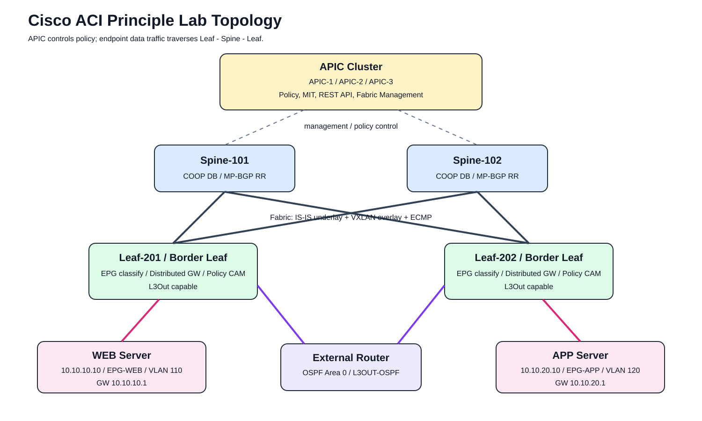
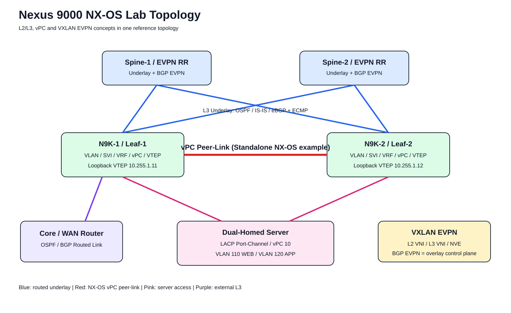

# ACI 및 Nexus9K

Cisco **ACI**와 **Nexus 9000 NX-OS**를 명령어 암기보다 **원리 → 제어 평면 → 데이터 평면 → 검증 명령 → 장애 분석** 순서로 학습하기 위한 저장소입니다.

- ACI 기준: **Cisco APIC / ACI 6.2(x)**
- Nexus 9000 기준: **Cisco NX-OS 10.6(x)**
- 문서 확인 기준일: **2026-10-06**
- 목표: 설정을 넣는 방법뿐 아니라 **왜 필요한지, 내부에서 어떤 상태가 생성되는지, 패킷이 실제로 어디를 통과하는지** 설명할 수 있는 수준

## 1. 두 영역의 차이를 먼저 잡기

| 영역 | ACI | Nexus 9000 NX-OS |
|---|---|---|
| 구성 모델 | APIC Policy / Managed Object | 장비 CLI / NX-OS feature |
| L2 분류 | EPG + access encap + BD | VLAN + access/trunk |
| L3 분리 | Tenant / VRF / BD | VRF + SVI / routed port |
| 이중화 | ACI vPC | NX-OS vPC |
| Overlay | Fabric VXLAN을 ACI가 관리 | VXLAN EVPN을 직접 설계/구성 |
| Endpoint 위치 | COOP 등 ACI fabric control plane | MAC/ARP/ND + EVPN route |
| 보안 정책 | EPG Contract / zoning rule | ACL, VACL, PACL 등 |
| 외부 라우팅 | L3Out + External EPG + Contract | Routed interface/SVI + OSPF/BGP/static |
| Source of Truth | APIC | 각 NX-OS switch 구성 |

핵심은 **같은 Nexus 9000 하드웨어 계열이라도 ACI mode와 standalone NX-OS mode의 운영 모델은 완전히 다르다**는 점입니다.

---

# A. Cisco ACI

ACI는 다음 세 층으로 이해합니다.

1. **물리 Fabric**: Spine-Leaf, TEP, IS-IS, ECMP
2. **Policy Model**: Tenant → VRF / BD / App Profile → EPG → Contract
3. **실제 배포 결과**: endpoint table, route table, COOP DB, zoning rule/filter

## ACI 학습 순서

| 순서 | 문서 | 핵심 |
|---|---|---|
| 1 | [Architecture](docs/01_ARCHITECTURE.md) | APIC / Leaf / Spine / TEP / VXLAN |
| 2 | [Fabric Bootstrap](docs/02_FABRIC_BOOTSTRAP.md) | Fabric discovery와 IS-IS |
| 3 | [Access Policies](docs/03_ACCESS_POLICIES.md) | VLAN Pool / Domain / AAEP / Policy Group |
| 4 | [Tenant / VRF / BD](docs/04_TENANT_VRF_BD.md) | L2/L3 scope |
| 5 | [EPG / Static Binding](docs/05_EPG_STATIC_BINDING.md) | endpoint classification |
| 6 | [Contracts](docs/06_CONTRACTS.md) | pcTag와 zoning |
| 7 | [ACI vPC](docs/07_VPC.md) | ACI 방식의 dual-homing |
| 8 | [L3Out](docs/08_L3OUT.md) | 외부 routing + policy |
| 9 | [Packet Walk](docs/09_PACKET_WALK.md) | 실제 packet forwarding |
| 10 | [CLI / REST API](docs/10_CLI_REST_API.md) | MO / DN / moquery |
| 11 | [Troubleshooting](docs/11_TROUBLESHOOTING.md) | 단계별 장애 분석 |
| 12 | [Labs](docs/12_LABS.md) | 실습 |
| 13 | [Glossary](docs/13_GLOSSARY.md) | 용어 |
| 14 | [Command Index](docs/14_COMMAND_INDEX.md) | APIC / Leaf / Spine 명령 |



---

# B. Nexus 9000 NX-OS

Standalone Nexus 9000은 다음 순서로 학습합니다.

```text
Hardware / NX-OS
   ↓
Feature Model
   ↓
Interface / VLAN / STP
   ↓
Port-Channel / LACP
   ↓
vPC
   ↓
VRF / SVI / Routed Port
   ↓
OSPF / BGP
   ↓
VXLAN EVPN
   ↓
Operations / Upgrade / Troubleshooting
```

## Nexus 9000 학습 순서

| 순서 | 문서 | 핵심 |
|---|---|---|
| 1 | [Overview](nexus9k/00_OVERVIEW.md) | Nexus 9000과 NX-OS의 구조 |
| 2 | [NX-OS Foundations](nexus9k/01_NXOS_FOUNDATIONS.md) | feature model / CLI / control-data plane |
| 3 | [Initial Setup](nexus9k/02_INITIAL_SETUP.md) | mgmt0 / management VRF / SSH / NTP |
| 4 | [L2 / VLAN / STP](nexus9k/03_L2_VLAN_STP.md) | access/trunk, MAC learning, STP |
| 5 | [Port-Channel / LACP](nexus9k/04_PORT_CHANNEL_LACP.md) | bundle 원리와 hashing |
| 6 | [NX-OS vPC](nexus9k/05_VPC.md) | peer-link / keepalive / consistency |
| 7 | [L3 / VRF / Routing](nexus9k/06_L3_VRF_ROUTING.md) | routed port / SVI / OSPF / BGP |
| 8 | [VXLAN EVPN](nexus9k/07_VXLAN_EVPN.md) | underlay / NVE / VNI / BGP EVPN |
| 9 | [FEX](nexus9k/08_FEX.md) | Nexus 2000 / FEX architecture |
| 10 | [Operations](nexus9k/09_OPERATIONS.md) | logging / NTP / SPAN / resources |
| 11 | [Upgrade](nexus9k/10_UPGRADE.md) | image / impact check / install all / ISSU |
| 12 | [Troubleshooting](nexus9k/11_TROUBLESHOOTING.md) | L1→L2→vPC→L3→VXLAN |
| 13 | [Labs](nexus9k/12_LABS.md) | 단계별 실습 |
| 14 | [Command Index](nexus9k/13_COMMAND_INDEX.md) | 실무 명령 모음 |
| 15 | [ACI vs NX-OS](nexus9k/14_ACI_VS_NXOS.md) | 두 운영 모델 직접 비교 |



## Nexus 9000에서 먼저 기억할 명령

```text
show version
show module
show inventory
show feature
show interface status
show vlan brief
show mac address-table
show spanning-tree
show port-channel summary
show lacp counters
show vpc
show vpc consistency-parameters global
show vrf
show ip route
show bgp sessions
show nve peers
show bgp l2vpn evpn summary
```

---

# C. 가장 중요한 공통 원리

## 1. Control Plane과 Data Plane을 분리해서 봅니다

설정이 존재한다는 사실과 실제 forwarding state가 존재한다는 사실은 다릅니다.

```text
Configuration
→ Control-plane state
→ Hardware/forwarding state
→ Packet result
```

## 2. Route가 있다고 통신되는 것은 아닙니다

ACI에서는 Contract가 별도로 필요할 수 있고, NX-OS에서도 ACL/VRF/VLAN/vPC 상태가 forwarding을 막을 수 있습니다.

## 3. vPC는 한 대의 스위치를 만드는 기술이 아닙니다

NX-OS vPC는 L2 관점에서 downstream 장비에게 하나의 논리적 Port-Channel처럼 보이게 하지만 **두 Nexus는 독립된 control plane을 가진 두 장비**입니다.

ACI vPC는 동일한 목적을 가지지만 APIC/Fabric 기반으로 구성되므로 standalone NX-OS vPC의 peer-link 모델을 그대로 대입하면 안 됩니다.

## 4. VXLAN은 VLAN을 없애는 기술이 아니라 확장 방식이 바뀌는 것입니다

Access 구간에서는 여전히 VLAN이 사용될 수 있습니다. Fabric 내부에서는 VXLAN VNI가 overlay segment를 식별하며, EVPN을 사용하는 NX-OS fabric에서는 BGP가 MAC/IP reachability를 control plane으로 배포합니다.

---

Cisco 공식 출처와 버전 기준은 [SOURCES.md](SOURCES.md)에 정리했습니다.
